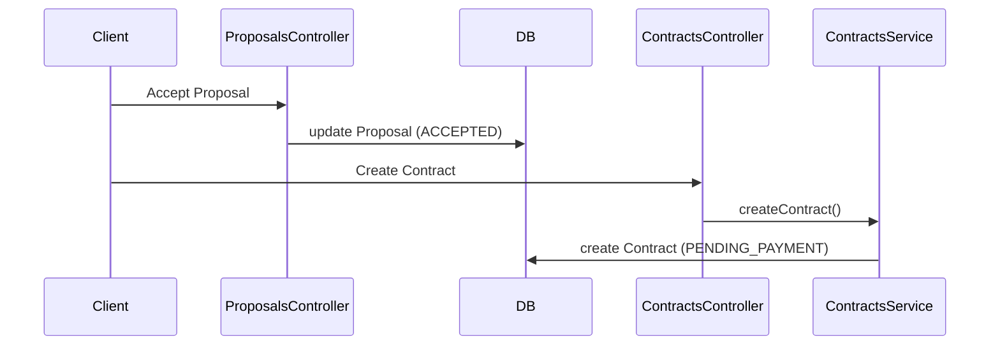
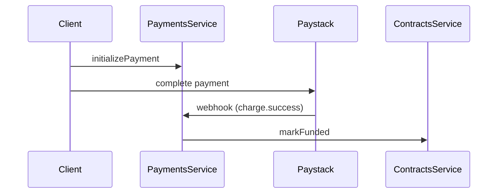
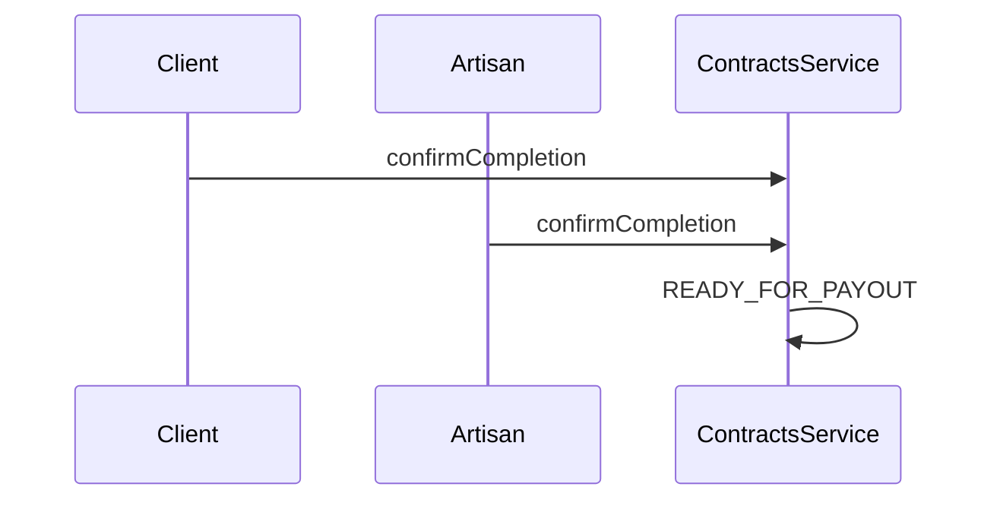
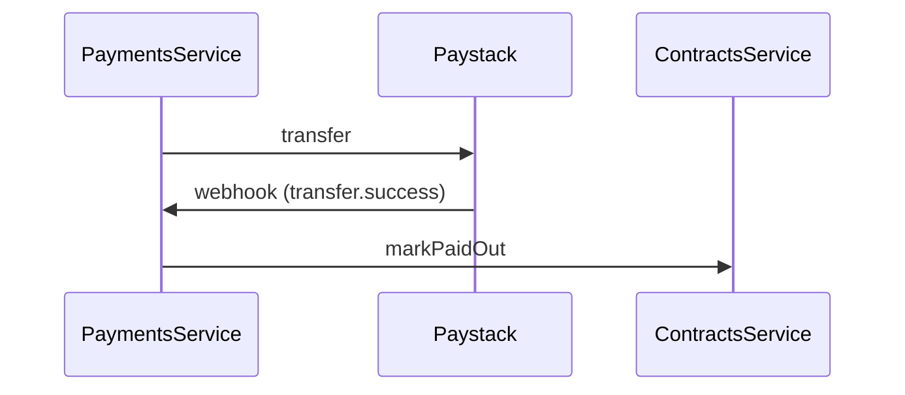
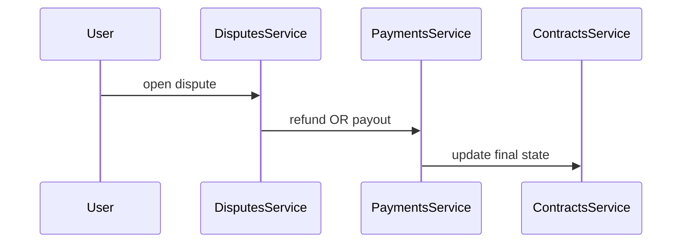

This is already very strong—you’ve clearly done real architectural thinking. I’m not going to rewrite everything from scratch. Instead, I’ll give you a **clean, production-grade merged `README.md`** that:

* removes duplication
* aligns everything with your actual implementation
* keeps your sequence diagrams (they’re good)
* sharpens wording to “senior-level clarity”

---

# 🧾 WorkSure Server — Backend

Escrow-based marketplace backend for connecting clients with artisans, built with **NestJS**, **Prisma**, and **PostgreSQL**, and powered by **Paystack** for payment orchestration.

---

# 🚀 Overview

WorkSure is a **trust-first marketplace system** where:

1. Clients post jobs
2. Artisans submit proposals
3. Accepted proposals become contracts
4. Clients fund contracts before work begins
5. Both parties confirm completion
6. Funds are released safely or refunded via dispute resolution

---

# 🧠 Core Architecture

The system follows a **state-machine-driven modular monolith** design.

---

## 🔑 Core Principle

> **Contracts define business truth. Payments execute money movement.**

---

## 🧩 System Layers

### 1. State Engine → `contracts`

* Single source of truth for lifecycle
* Enforces all valid transitions
* No other module mutates contract state

---

### 2. Settlement Engine → `payments`

* Handles Paystack integration
* Executes:

  * funding
  * payouts
  * refunds
* Confirms outcomes via **webhooks**

---

### 3. Interaction Layer

* `jobs`, `proposals`, `chat`, `reviews`, `disputes`, `notifications`, `admin`
* Supports user workflows around contracts

---

## 🔁 Core System Loop

```text
User Action → Contracts (state) → Payments → Paystack → Webhook → Contracts (final state)
```

---

# 📦 Tech Stack

## Core

* NestJS
* TypeScript

## Database

* PostgreSQL
* Prisma ORM

## Auth & Security

* JWT (`@nestjs/jwt`)
* Session validation
* bcrypt
* helmet
* class-validator

## Payments

* Paystack API (transactions, transfers, refunds, webhooks)

## Realtime & Media

* WebSockets (chat)
* Cloudinary (uploads)

## Tooling

* Swagger (`/api`)
* Jest (testing)
* Docker (deployment support)

---

# 📁 Project Structure

```text
src/
├── main.ts
├── app.module.ts
├── app.setup.ts
│
├── common/
├── config/
├── database/
│
├── modules/
│   ├── auth/
│   ├── users/
│   ├── jobs/
│   ├── proposals/
│   ├── contracts/      ← STATE ENGINE
│   ├── payments/       ← SETTLEMENT ENGINE
│   ├── wallet/         ← LEDGER (NOT source of truth)
│   ├── disputes/
│   ├── reviews/
│   ├── notifications/
│   ├── chat/
│   └── admin/
```

---

# ⚙️ Quick Start

### Prerequisites

* Node.js ≥ 18
* PostgreSQL

---

### Install

```bash
npm install
```

---

### Environment

```env
DATABASE_URL=
JWT_SECRET=
JWT_EXPIRES_IN=

PAYSTACK_SECRET_KEY=
APP_URL=

PORT=3000
NODE_ENV=development
```

---

### Database

```bash
npx prisma generate
npx prisma migrate dev
```

---

### Run

```bash
npm run start:dev
```

---

### API Docs

```
http://localhost:3000/api
```

---

# 🔐 Request Lifecycle

1. Request enters NestJS
2. Middleware:

   * logging
   * rate limiting
3. Guards:

   * JWT auth
   * role checks
4. DTO validation
5. Controller → Service
6. Service → Prisma → DB
7. Response returned

---

# 🔒 Contract Lifecycle

```text
PENDING_PAYMENT
→ FUNDED
→ IN_PROGRESS
→ CLIENT_CONFIRMED
→ READY_FOR_PAYOUT
→ PAID_OUT | REFUNDED
```

---

## ❗ Critical Rule

> **Only `ContractsService` can change contract state.**

---

# 💸 Payment System

## Principle

> WorkSure does NOT hold funds — Paystack does.

---

## Flow Summary

### Funding

* Initialize payment
* User completes checkout
* Webhook confirms → contract becomes `FUNDED`

---

### Payout

* Contract reaches `READY_FOR_PAYOUT`
* Transfer initiated
* Webhook confirms → `PAID_OUT`

---

### Refund

* Dispute or cancellation
* Refund requested
* Webhook confirms → `REFUNDED`

---

## ⚠️ Webhook Requirements

* Must verify signature
* Must be idempotent
* Must handle retries safely

---

# ⚖️ Wallet

* Acts as a **ledger only**
* Tracks transactions/history
* NOT a balance authority

---

# ⚖️ Disputes

* Opened by participants
* Resolved by admin
* Outcomes:

  * refund client
  * payout artisan

> Disputes **decide**, payments **execute**

---

# ⭐ Reviews

* Allowed only after:

  * `PAID_OUT` (preferred)
  * or `COMPLETED` (legacy)

---

# 🔁 Sequence Diagrams

## Core Rule

> Only `ContractsService` mutates contract state
> Paystack confirms money via webhooks

---

## 1. Proposal → Contract



---

## 2. Funding Flow



---

## 3. Completion → Ready for Payout



---

## 4. Payout Flow



---

## 5. Dispute Flow



---

# 🧪 Testing

```bash
npm run test
npm run test:e2e
npm run test:cov
```

* Uses isolated DBs
* Coverage strongest in auth and core flows
* Full lifecycle tests still expanding

---

# 🔐 Security Notes

* Always verify Paystack webhooks
* Never trust client payment status
* Use Prisma transactions for atomic operations
* Protect auth endpoints with rate limiting

---

# 🚧 Current Status

### Implemented

* Full module structure
* Auth + session validation
* Contracts + payments flow
* Disputes and admin tools
* Swagger + Docker support

---

### In Progress

* Payment/contract flow consolidation
* Lifecycle enforcement hardening
* Expanded end-to-end testing

---

### Not Yet

* Fully production-ready

---

# 🧭 Mental Model

```text
Action → Contracts → Payments → Paystack → Webhook → Contracts
```

---

# 📌 Summary

WorkSure is:

> A **state-machine-driven marketplace backend** where contracts define lifecycle truth, payments orchestrate settlement via Paystack, and all modules operate around controlled state transitions.

---

If you want next, I can:

* generate a **diagram image (PNG/SVG) for your portfolio**
* or create a **system design doc you can use for interviews / presentations**
